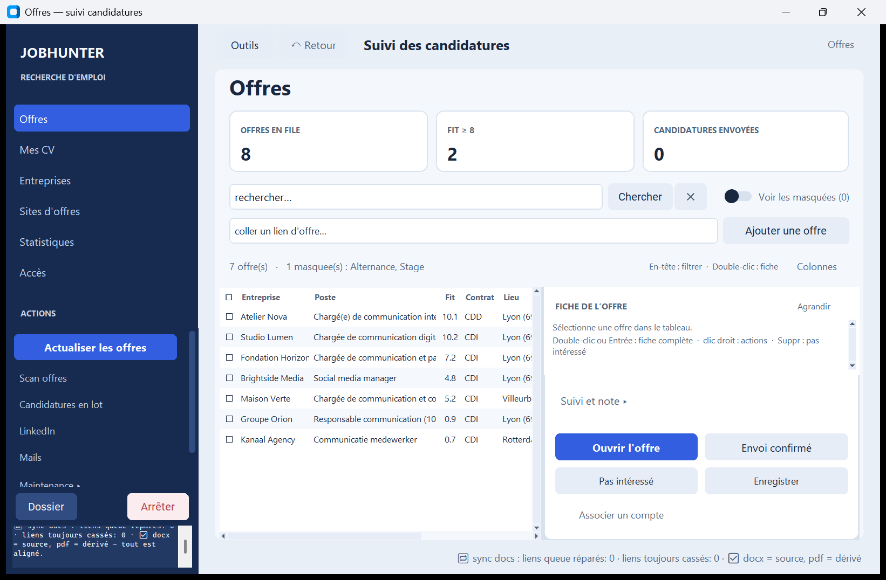
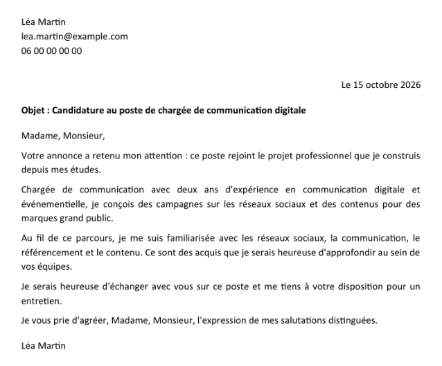

# JobHunter

[](https://github.com/Grisbix/JobHunter/actions/workflows/tests.yml)
[](https://github.com/Grisbix/JobHunter/releases/latest)
[](LICENSE)

[🇬🇧 English](README.md) · 🇫🇷 Français

**Ta recherche d'emploi, préparée chaque matin.** JobHunter collecte les offres de dizaines
de sources, les note de 1 à 10 selon **ton** profil, et prépare pour chacune un CV adapté,
une lettre de motivation et un court message. **Il n'envoie jamais rien** : le clic
« Envoyer » reste le tien.

Tout tourne sur ton ordinateur. Ton CV et tes candidatures ne quittent pas ta machine.

<p align="center">
  <a href="https://github.com/Grisbix/JobHunter/releases/latest/download/JobHunterSetup.exe"></a>
  &nbsp;
  <a href="#depuis-le-code-source-windows"></a>
</p>

<p align="center"><sub>Windows 10/11 · sans Python ni droits d'administrateur · tes données restent dans <code>Documents\JobHunter</code></sub></p>

| Les offres, triées pour ton profil | La lettre préparée pour une offre |
|---|---|
|  |  |

<sub>Captures faites avec un profil et des offres **fictifs** (Léa Martin, chargée de communication à Lyon) : le profil créé par le premier lancement, avant tout complément par Claude.</sub>

- [Installer (Windows)](#installer-windows) · [Depuis le code source](#depuis-le-code-source-windows) · [macOS / Linux](#macos--linux)
- [Paramétrer ton profil avec Claude](#paramétrer-ton-profil-avec-claude-code)
- [Au quotidien](#au-quotidien)
- [Le profil](#le-profil)
- [Pour aller plus loin](#pour-aller-plus-loin)
- [Règles du projet](#règles-du-projet)
- [Dépannage](#dépannage)

---

## Installer (Windows)

1. **Télécharge [`JobHunterSetup.exe`](https://github.com/Grisbix/JobHunter/releases/latest/download/JobHunterSetup.exe)**
   et lance-le. Pas de Python à installer, pas de droits d'administrateur : JobHunter
   s'installe pour toi seul et ajoute un raccourci au menu Démarrer.
2. **Au premier lancement**, choisis ton CV (`.docx` de préférence) : JobHunter le lit et
   pose cinq questions (métiers visés, expérience, villes, accords, secteur).
3. **Clique sur « Actualiser les offres »** : la collecte, la note et les documents se font
   depuis l'application.

Tes données (profil, CV, lettres, offres, suivi) vivent dans `Documents\JobHunter` : la
mise à jour et la désinstallation n'y touchent jamais. Pour mettre à jour, l'application te
propose la nouvelle version au démarrage ; télécharge et lance le nouvel installateur.

Conseillés : [LibreOffice](https://www.libreoffice.org/download/) (CV et lettres en PDF) et
Google Chrome (candidature semi-automatique ; à défaut, la collecte utilise Edge, présent sur
tout Windows).

## Depuis le code source (Windows)

Pour personnaliser JobHunter ou le développer : le code complet, avec Python.

**Les outils**

| Outil | | À quoi il sert |
|---|---|---|
| [Python 3.12+](https://www.python.org/downloads/) | **obligatoire** | fait tourner JobHunter — `installer.bat` propose de l'installer s'il manque |
| [LibreOffice](https://www.libreoffice.org/download/) | conseillé | CV et lettres en PDF (sinon `.docx`) |
| [Claude Code](https://claude.com/claude-code) | conseillé | paramètre tout ton profil depuis ton CV |
| [Git](https://git-scm.com/downloads) | facultatif | récupérer les mises à jour (`git pull`) |
| [Ollama](https://ollama.com/) | facultatif | lettres rédigées par une IA locale et gratuite |

**Les 4 étapes**

1. **Télécharge** la [dernière version](https://github.com/Grisbix/JobHunter/releases/latest) (fichier `JobHunter-….zip`) et dézippe-le.
2. **Double-clique sur `installer.bat`** — bibliothèques Python et navigateur Chromium (quelques minutes, une seule fois).
   Sans Python, il propose de l'installer pour toi (winget) : accepte, ferme la fenêtre, relance-le.
3. **Dépose ton CV dans `Mon_CV`** — un `.docx` de préférence (voir ci-dessous). Ce dossier n'est jamais publié.
4. **Double-clique sur `lancer.bat`** — la première fois, il crée ton profil en lisant ton CV et en
   posant cinq questions (métiers visés, expérience, villes, accords, secteur) ; ensuite il ouvre
   directement l'application. (Tu peux aussi ouvrir `JobHunter.pyw` : sans profil, il te propose
   de choisir ton CV.)

**Ensuite, deux outils en un double-clic :**

- **`planifier.bat`** — lance la collecte chaque matin à 8 h (`planifier.bat 07:30` pour une autre
  heure, `planifier.bat supprimer` pour l'arrêter). Journaux dans `Scripts\_logs\`.
- **`mettre_a_jour.bat`** — récupère la dernière version (l'application te la propose aussi
  d'elle-même au démarrage, et se relance après). Elle affiche les nouveautés, installe, vérifie
  que tout se charge et **revient seule à la version d'avant** si ce n'est pas le cas. Ton
  profil, ton CV, tes lettres et ton suivi ne sont **jamais** touchés ; un fichier du programme
  que tu as modifié est gardé, la nouvelle version posée à côté en `.nouveau`. Les anciennes
  versions vont dans `_sauvegarde_maj\` ; `mettre_a_jour.bat --annuler` y revient.
  L'application te prévient elle-même au démarrage quand une nouvelle version sort.

> **Pourquoi un `.docx` ?** Chaque CV envoyé part de ce modèle. Écris `[nom du poste]` dans ton
> accroche : l'intitulé exact de l'offre s'y insère. Un PDF est envoyé tel quel, sans adaptation.

### macOS / Linux

Mêmes étapes, avec les scripts `.sh` dans un terminal ouvert dans le dossier (Python 3.12+ et, sous Linux, `python3-tk` à installer d'abord) :

```bash
./installer.sh
./lancer.sh          # crée le profil depuis Mon_CV, puis ouvre l'application
./planifier.sh        # collecte chaque matin (cron)
./mettre_a_jour.sh
```

> Les scripts `.sh` sont vérifiés mais **pas encore éprouvés sur un vrai Mac** : signale tout souci.

<details>
<summary>Installation manuelle (sans les scripts)</summary>

```bash
pip install -r requirements.txt
python -m playwright install chromium
python JobHunter.pyw profil "chemin/vers/mon_CV.docx"
python JobHunter.pyw
```
</details>

## Paramétrer ton profil avec Claude Code

Le premier lancement crée un profil **qui marche**, mais sommaire. Pour un profil complet,
ouvre [Claude Code](https://claude.com/claude-code) dans le dossier JobHunter et tape :

```
/configurer-profil Mon_CV\mon_CV.docx
```

Claude lit ton CV, te pose ses questions en un seul message, puis remplit tout : variantes
d'intitulés de ton métier, compétences et leurs synonymes dans les annonces, notation des
offres, filtres, recherches lancées sur les sites, paragraphes de lettre. Il vérifie que les
offres de ton métier passent et que les autres sont écartées, puis te dit ce qui reste à
compléter. **Il n'invente aucun fait** : ce qui n'est pas dans ton CV, il te le demande.

## Au quotidien

| Quoi | Comment |
|---|---|
| Ouvrir l'application | `lancer.bat` (ou `python JobHunter.pyw`) |
| Collecte + tri + CV/lettres des meilleures offres (1 à 3 h) | `python JobHunter.pyw pipeline` |
| Collecte LinkedIn seule / essai sans rien écrire | `python JobHunter.pyw collecte --linkedin [--dry]` |
| CV + lettre des 20 meilleures offres | `python JobHunter.pyw documents --top 20` |
| Refaire CV et lettre d'une offre | `python JobHunter.pyw documents --url <morceau-du-lien>` |
| Remplissage semi-automatique d'un formulaire | dans l'application : coche des offres, « Postuler la sélection » (panneau Candidatures) ; ou `python JobHunter.pyw postuler --canal linkedin` dans un terminal |

Les mêmes programmes ont une entrée unique : `python -m jobhunter` liste les commandes
(`collecte`, `documents`, `postuler`, `pipeline`, `maj`…), avec `src` dans `PYTHONPATH` ;
`python -m jobhunter documents --top 20` équivaut à la ligne du tableau.

**Chaque matin automatiquement** : `planifier.bat` (voir plus haut).
**Mettre à jour** : `mettre_a_jour.bat` (ou le bouton « Mettre à jour JobHunter » de l'app) ;
`python JobHunter.pyw maj --verifier` pour seulement voir ce qu'apporte la nouvelle version,
`--annuler` pour revenir à la précédente. Nouveautés de chaque version : [`CHANGELOG.md`](CHANGELOG.md).

## Le profil

Tout ce qui te concerne vit dans **`profil/profil.json`**. Le moteur ne connaît aucun métier :
pour changer de cible, on change le profil. Modèle complet : `profil/exemple_finance_esg.json`
(un junior en finance durable).

| Rubrique | Contenu |
|---|---|
| `identite` | nom, email, téléphone, ville, `genre` (m/f pour les accords) |
| `langues_parlees` | `["fr", "en", …]` — une annonce rédigée dans une autre langue est notée 2 au plus, une qui en exige une, 4 |
| `domaines` | un par métier visé : intitulés, CV à utiliser, **paragraphe de parcours** de la lettre |
| `competences` | tes compétences et les mots des annonces qui les désignent |
| `scoring` | comment une offre est notée : cœur du métier, plafonds, intitulés hors cible |
| `niveau` | junior, confirmé ou senior : malus d'expérience |
| `filtre_titre` | mots requis dans un intitulé pour le collecter, mots qui l'écartent |
| `tri` | familles de métiers retirées de la file |
| `zones` | secteurs prioritaires et secondaires (`idf`, `lyon`, `nantes`…) |
| `collecte.mots_cles` | recherches lancées sur LinkedIn, WTJ… |
| `message`, `lettre` | diplôme, langues, phrases de profil, faits par compétence |

Contrôler le profil, sans réseau :

```bash
python JobHunter.pyw voir-profil                                              # il se lit ?
python JobHunter.pyw verifier-profil "Chargé de communication" "Développeur Java"
```

Le second dit, pour chaque intitulé, s'il est collecté ou écarté, son domaine et sa note.

## Pour aller plus loin

- **Ligne de CV propre à une offre** : `CV/Faits.json` (format dans `profil/exemple_Faits.json`,
  utilisée seulement si `"valide": true`).
- **Lettre écrite à la main** : `Lettres/Sur_mesure/<entreprise>__<poste>.txt` remplace le
  corps de la lettre générée.
- **Entreprises suivies directement** : `Scripts/sources_config.json` ;
  `python JobHunter.pyw probe_ats` trouve le flux carrière d'une entreprise.
- **Adzuna, Jooble** : crée toi-même une clé d'API gratuite et mets-la dans
  `Scripts/adzuna.json` / `Scripts/jooble.json` (jamais publiés). Sans clé, sources ignorées.
- **Lettres par IA locale** : installe [Ollama](https://ollama.com/), puis `ollama pull llama3.1:8b`.

## Règles du projet

- **Aucun envoi automatique.** Le clic final est toujours le tien.
- **Aucun contournement anti-bot.** Navigateur standard, qui se déclare automatisé. Un site qui
  refuse (403, CAPTCHA) est laissé tranquille 30 jours.
- **Aucun mot de passe** lu, stocké ni tapé par les programmes ; aucune création de compte
  automatique. Les connexions aux sites carrière se font à la main.
- **Jamais ton profil Chrome personnel** : JobHunter utilise un profil dédié.
- **Tes données restent chez toi** : profil, CV, lettres, offres et suivi sont ignorés par git.

## Dépannage

| Symptôme | Cause probable |
|---|---|
| « Python est introuvable » | Python non installé, ou « Add Python to PATH » non coché : réinstaller |
| « Profil introuvable » | lancer `lancer.bat`, ou `/configurer-profil` dans Claude Code |
| Aucune offre ne passe | `filtre_titre.metier` trop étroit, ou `collecte.mots_cles` trop rares |
| Trop d'offres hors sujet | compléter `filtre_titre.exclus`, resserrer `filtre_titre.metier` |
| Lettre sans paragraphe de parcours | `domaines[].parcours_fr` vide |
| CV non adapté à l'offre | CV fourni en PDF : fournir un `.docx` |
| L'application ne s'ouvre pas | lancer `python JobHunter.pyw` dans un terminal pour lire l'erreur |
| « 429 » pendant la collecte | limite de débit d'un site : la collecte attend et reprend seule |
| « 403 » ou « challenge » | refus du site : il est ignoré, c'est voulu |

---

**Licence** : [MIT](LICENSE).

**Développeurs** : architecture, conventions et tests dans [`AGENTS.md`](AGENTS.md) et
[`CONTRIBUTING.md`](CONTRIBUTING.md) ; `python -m pytest -q` lance environ 1 850 tests sans
réseau, sur le profil d'exemple.
