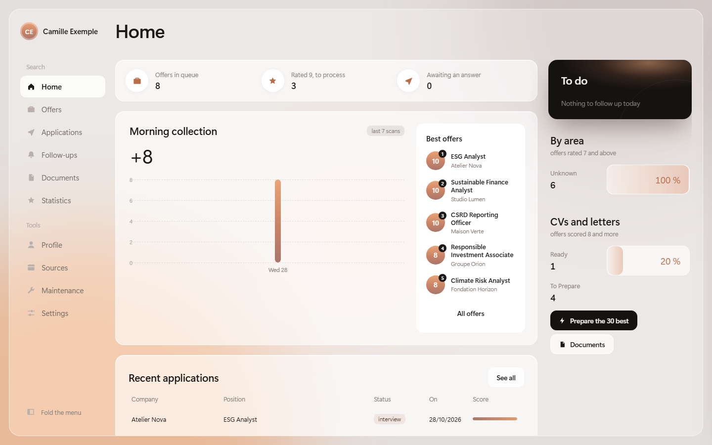
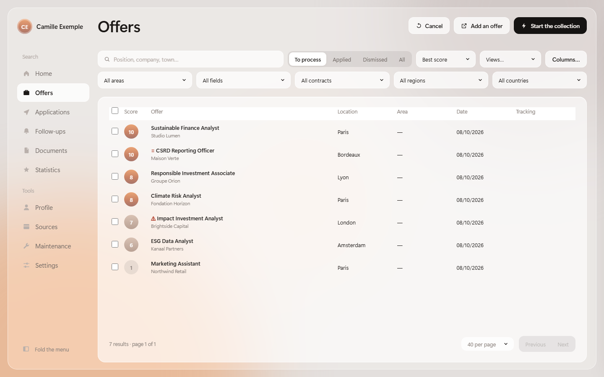
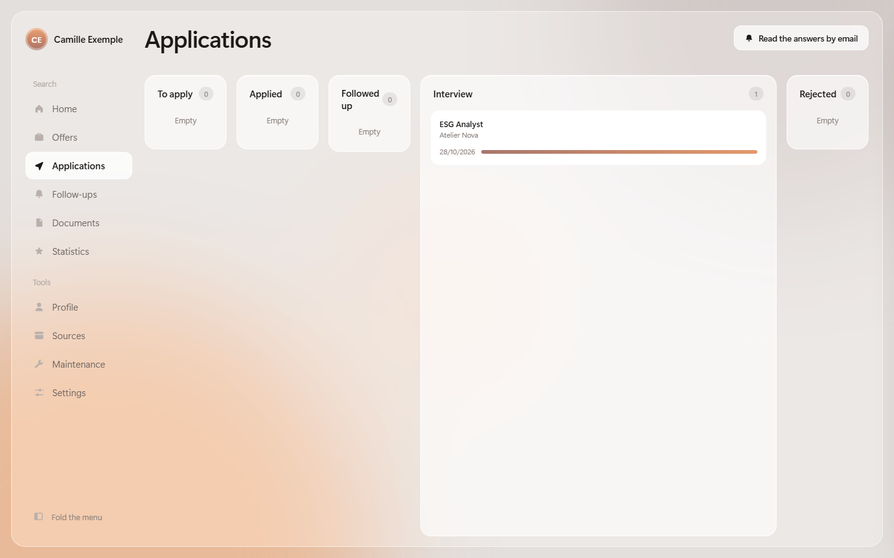
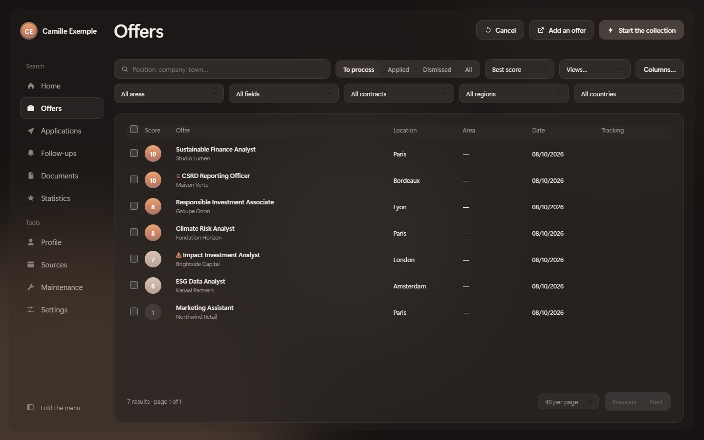
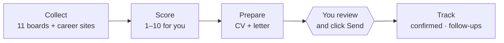

<div align="center">

# JobHunter

**Your job search, prepared every morning — and the final click stays yours.**

JobHunter collects offers from 11 job boards and 20+ kinds of company career sites, ranks
them from 1 to 10 against **your** profile, and prepares a tailored CV, cover letter and
short message for each one. It runs on your computer. It never sends an application.

[](https://github.com/Grisbix/JobHunter/actions/workflows/tests.yml)
[](https://github.com/Grisbix/JobHunter/releases/latest)


[](LICENSE)

🇬🇧 English · [🇫🇷 Français](README.fr.md)

<a href="https://github.com/Grisbix/JobHunter/releases/latest/download/JobHunterSetup.exe"></a>
&nbsp;
<a href="#from-source"></a>

<sub>Windows 10/11 · no Python, no administrator rights · interface in English, French, German or Spanish · your data stays in <code>Documents\JobHunter</code></sub>

</div>

| Home: the morning's collection, the best offers, what to do | Offers, ranked for your profile |
|---|---|
|  |  |
| **Applications, from « to apply » to the interview** | **…and the offers, in dark mode** |
|  |  |

<sub>Screenshots in English, with a **fictitious** profile and invented companies (Camille Exemple, junior in sustainable finance — `profile/example_finance_esg.json`). Rebuilt by `python tools/screenshots.py`. The app also speaks **French, German and Spanish**: Settings → Interface language.</sub>

- [Why](#why-jobhunter) · [How it works](#how-it-works) · [Sources](#sources)
- [Install (Windows)](#install-windows) · [From source](#from-source) · [macOS / Linux](#macos--linux)
- [Set up your profile with Claude Code](#set-up-your-profile-with-claude-code) · [Day to day](#day-to-day) · [The profile](#the-profile)
- [Project rules](#project-rules) · [Built to be trusted](#built-to-be-trusted) · [Troubleshooting](#troubleshooting)

## Why JobHunter

Most job-search tools are either **scrapers** (a pile of offers, unranked, nothing prepared)
or **auto-apply bots** (hundreds of identical applications sent in your name, accounts
banned, recruiters annoyed). JobHunter sits in between:

| | Scrapers | Auto-apply bots | **JobHunter** |
|---|:---:|:---:|:---:|
| Collects from boards *and* company career sites | some | some | ✅ |
| Ranks offers against **your** profile, and says why | — | rarely | ✅ |
| CV and letter tailored to each offer, from facts you gave | — | generic | ✅ |
| Fills the form, attaches the documents | — | ✅ | ✅ |
| Clicks “Send” for you | — | ✅ | **never, by design** |
| Bypasses CAPTCHAs and anti-bot walls | often | often | **never** |
| Your CV and applications stay on your machine | varies | cloud | ✅ |

## How it works



1. **Collect.** Every morning (or on a click), offers come from the boards below and from the
   career pages of the companies you follow. A site that rate-limits is waited for and
   resumed; a site that refuses is left alone for 30 days.
2. **Score.** Each offer gets a fit from 1 to 10, computed from your profile: target jobs,
   skills and the words offers use for them, experience, languages, places. Click an offer
   to see *why* it scored what it did.
3. **Prepare.** For the best offers: a CV started from your own `.docx` with the offer's exact
   job title, a cover letter built only from facts you provided, and a short message for
   forms. A check flags anything missing before you apply.
4. **Apply, yourself.** JobHunter opens the form, fills it, attaches the documents and
   highlights the Send button. You read, you click. The tracker then records whether the site
   **confirmed** the application or whether it is only **declared** — with the text it saw
   and a screenshot.
5. **Follow up.** Follow-up drafts after 7 days, statuses proposed from your recruiter emails
   (read-only, each one validated by you), weekly figures.

## Sources

| Job boards | Company career sites |
|---|---|
| LinkedIn (public pages, no login) · Welcome to the Jungle · Jobs that make sense (impact jobs) · eFinancialCareers (9 countries) · EURES (EU) · V.I.E (Business France) · FIR · **official APIs**: France Travail, Adzuna, Jooble · on request only: APEC, Glassdoor (they refuse automated visits) | Greenhouse · Lever · Ashby · Workday · SmartRecruiters · Recruitee · Teamtailor · Workable · iCIMS · SuccessFactors · Oracle · Phenom · Eightfold · Avature · Cornerstone · Talentsoft · Pinpoint · Personio · Breezy · and more |

Add a company from the app (**Entreprises** → paste its careers link): JobHunter recognises the
platform and follows it; each company shows its last collection, and can be suspended
without losing anything. Each source shows its last result in **Accès**: offers found,
rate-limited, or refused — an empty day is never mistaken for a quiet one.

## Install (Windows)

1. **Download [`JobHunterSetup.exe`](https://github.com/Grisbix/JobHunter/releases/latest/download/JobHunterSetup.exe)**
   and run it. No Python, no administrator rights: JobHunter installs for you only and adds
   a Start menu shortcut.
2. **On first launch**, pick your CV (`.docx` preferred): JobHunter reads it and asks five
   questions (target jobs, experience, cities, grammatical gender for French letters, sector).
3. **Click “Actualiser les offres”** (refresh offers): collection, scoring and documents all
   run from the app.

Your data (profile, CV, letters, offers, application log) lives in `Documents\JobHunter`:
updates and uninstalling never touch it. The app offers each new version at start-up.

Recommended: [LibreOffice](https://www.libreoffice.org/download/) (CVs and letters as PDF)
and Google Chrome (form filling; without it, collection uses Edge, which every Windows has).

## From source

To customise or develop JobHunter: the full code, with Python 3.12+.

| Tool | | What for |
|---|---|---|
| [Python 3.12+](https://www.python.org/downloads/) | **required** | runs JobHunter — `launchers\install.bat` offers to install it |
| [LibreOffice](https://www.libreoffice.org/download/) | recommended | CVs and letters as PDF (otherwise `.docx`) |
| [Claude Code](https://claude.com/claude-code) | recommended | sets up your whole profile from your CV |
| [Git](https://git-scm.com/downloads) | optional | fetch updates (`git pull`) |
| [Ollama](https://ollama.com/) | optional | letters written by a free local AI |

1. **Download** the [source code](https://github.com/Grisbix/JobHunter/releases/latest)
   (`Source code (zip)`) or clone the repository, and unzip it.
2. **Double-click `launchers\install.bat`**: Python libraries and the Chromium browser (a few
   minutes, once). Without Python, it offers to install it (winget). The libraries go
   into a `.venv` folder next to JobHunter, not into your computer's Python.
3. **Put your CV in `My_CV`**, or drag it onto the JobHunter window, a `.docx` preferably. This folder is never published.
4. **Double-click `launchers\start.bat`**: the first time, it builds your profile from your CV and five
   questions; then it opens the app.

Then: **`launchers\schedule.bat`** runs the collection every morning at 8:00 (`launchers\schedule.bat 07:30`
for another time, `launchers\schedule.bat supprimer` to stop), and **`launchers\update.bat`** fetches
the latest version, checks that everything loads and rolls back on its own otherwise. Your
profile, CV, letters and log are **never** touched.

**What is in the folder**: `launchers/` the double-click tools (Windows `.bat`, macOS/Linux
`.sh`) · `My_CV/` your CV · `profile/` your settings · `data/` the offers, the log of
your applications and the daily logs · `CV/`, `Letters/` the documents made for each offer ·
`src/` the program · `docs/`, `tests/`, `tools/` for developers.
Before 3.0 these folders had French names (`Scripts/`, `profil/`, `Mon_CV/`, `Lettres/`):
an installation from before takes the new names by itself the first time the app starts,
after a backup (`_backup_migration_….zip`); `jobhunter migrate` does it by hand.

> **Why a `.docx`?** Every CV sent starts from this template. Write `[nom du poste]` in your
> summary: the exact job title of the offer goes there. A PDF is sent as is, untailored.

### macOS / Linux

Same steps with the `.sh` scripts of `launchers/`, in a terminal opened in the JobHunter folder (Python 3.12+ and, on
Linux, `python3-tk` first):

```bash
./launchers/install.sh
./launchers/start.sh          # builds the profile from My_CV, then opens the app
./launchers/schedule.sh       # collection every morning (cron)
./launchers/update.sh
```

> On every change, CI runs `launchers/install.sh` on a Mac, then the whole test suite there, including opening every panel of the app in every language. Nobody has used it on their own Mac yet: please report issues.

## Set up your profile with Claude Code

The first launch creates a profile that **works**, but a basic one. For a complete profile,
open [Claude Code](https://claude.com/claude-code) in the JobHunter folder and type:

```
/configure-profile My_CV\my_CV.docx
```

Claude reads your CV, asks its questions in one message, then fills everything in: job-title
variants, skills and the words offers use for them, scoring, filters, searches, letter
paragraphs. It checks that offers in your field pass and others are dropped. **It invents
no facts**: whatever is not in your CV, it asks you.

## Day to day

| What | How |
|---|---|
| Open the app | Start menu, or `launchers\start.bat` from source |
| Collect + sort + CV/letters for the best offers | button “Actualiser les offres”, or `jobhunter pipeline` |
| CV + letter for the 20 best offers | `jobhunter documents --top 20` |
| Apply to the selected offers | in the app: tick offers, “Postuler la sélection” — you click Send |
| Does the ranking match my own judgements? | `jobhunter evaluation` |
| What did each source bring back? | `jobhunter yield` |
| Undo a clean-up of the offer list | `jobhunter restore --liste` |

`jobhunter` alone lists every command (from source: `python JobHunter.pyw <command>`).
Release notes: [`CHANGELOG.md`](CHANGELOG.md).

### The window

Since 3.29 the application opens in its modern window drawn in HTML (pywebview, installed
with JobHunter): light or dark mode (Settings → Mode, or follow Windows). The classic
window only opens when this one cannot (no web view on the machine), or on purpose with
`jobhunter bureau`. The guided application (tick offers, « Candidature guidée… ») fills
each form in Chrome and stops before sending: the Send click is always yours.

## The profile

Everything about you lives in **`profile/profile.json`**. The engine knows no trade: to change
target, change the profile. Full example: `profile/example_finance_esg.json` (a junior in
sustainable finance).

| Section | Content |
|---|---|
| `identite` | name, email, phone, city, `genre` (m/f, for French agreement) |
| `langues_parlees` | `["fr", "en", …]` — an offer written in another language scores 2 at most |
| `domaines` | one per target job: titles, CV to use, the letter's **background paragraph** |
| `competences` | your skills and the words offers use for them |
| `scoring` | how an offer is scored: core of the job, caps, off-target titles |
| `filtre_titre` | words required in a title to collect it, words that exclude it |
| `zones` | priority and secondary areas |
| `collecte.mots_cles` | searches run on LinkedIn, WTJ… |

Most of it can be changed in the app: **My search** edits the keywords and the title
filter (with a preview on your queue) and suggests skills from your CV, each with the
sentence that proves it.

Check it, offline: `jobhunter check-profile "Communications officer" "Java developer"`.

**Several searches?** Maintenance → "Profils…" → "Nouveau profil…": a CV, a name, the
same questions as the first time. Each profile has its own folder (`profiles/<name>/`:
queue, applications, CVs, letters); the API keys stay shared. Switching restarts the app;
the morning collection runs every profile. From a terminal: `jobhunter profiles` (list),
`use`, `new <cv> --name "…"`, `rename`, `archive` (moved to `profiles/_archives/`, never
deleted).

## Project rules

These hold since the first version and are not up for discussion:

- **No automatic sending.** The final click is always yours. There is no `--auto` or
  `--submit` flag, anywhere ([ADR 0005](docs/adr/0005-no-automatic-submission.md)).
- **No anti-bot circumvention.** A standard browser that declares itself automated. A site
  that refuses (403, CAPTCHA) is left alone for 30 days. Sites whose terms forbid automated
  collection are not collected.
- **No passwords** read, stored or typed by the programs; no automatic account creation.
- **Never your personal Chrome profile**: JobHunter uses a dedicated one.
- **Your data stays with you**: profile, CV, letters, offers and log are ignored by git.

## Built to be trusted

A tool that writes in your name has to be right. What backs JobHunter:

- **~2,300 offline tests** on a fictitious profile, on Windows (Python 3.12 and 3.14) and Linux,
  at every change.
- **A non-regression bench**: every change replays the scoring of 384 fictitious offers — and,
  before each release, of the 12,000+ real offers of its author — and must show **0 difference**
  unless the change is meant ([ADR 0006](docs/adr/0006-non-regression-bench.md)).
- **Generated-case tests** (Hypothesis): title cleaning, duplicate detection, scoring bounds and
  merges checked on thousands of generated inputs — they found two real bugs on their first run.
- **Every network failure tested**: each career-site reader against refusals, rate limits,
  server errors, timeouts and unreadable answers — always reported, never a silent “nothing new”.
- **Every panel opened without a console**, and again with damaged data files.
- **Safe data**: one write path per file, under lock, atomic; daily backups, and any clean-up can
  be undone. Your applications are never deleted by an automatic purge.
- **Update signatures** checked before installing (built in, [ADR 0012](docs/adr/0012-signed-updates.md);
  active once the author's public key ships), CodeQL analysis, CI actions pinned by hash, and
  [architecture decisions](docs/adr/) written down with their reason.

## Troubleshooting

| Symptom | Likely cause |
|---|---|
| “Profil introuvable” | run `launchers\start.bat`, or `/configure-profile` in Claude Code |
| No offer passes | `filtre_titre.metier` too narrow, or `collecte.mots_cles` too rare |
| Too many off-target offers | extend `filtre_titre.exclus` |
| CV not tailored to the offer | CV given as PDF: provide a `.docx` |
| “429” during collection | a site's rate limit: collection waits and resumes on its own |
| “403” or “challenge” | the site refuses: it is skipped, on purpose |

## Contributing

Ideas and bug reports are welcome in the [issues](https://github.com/Grisbix/JobHunter/issues).
For code: [`CONTRIBUTING.md`](.github/CONTRIBUTING.md), then [`AGENTS.md`](AGENTS.md) (architecture,
conventions) and [`docs/`](docs/README.md) (programs, pitfalls learned the hard way, roadmap).
`python -m pytest -q` runs the whole suite offline. Comments and docs are in English;
function names and profile keys stay in French, so existing profiles keep working.

<div align="center"><sub>MIT licence · built for a real job search, shared so it can serve yours</sub></div>
